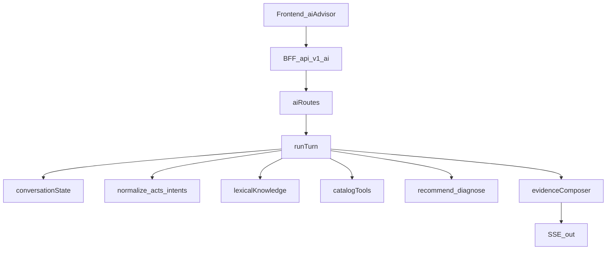

# RunRacks owned AI agent — how it works

Live advisor path: in-process, deterministic agent. **No OpenAI, no cloud LLM keys, no Ollama.**  
Contracts: [`AI_MODULE_DESIGN.md`](./AI_MODULE_DESIGN.md). Coverage gaps: [`AI_COVERAGE_REPORT.md`](./AI_COVERAGE_REPORT.md).

---

## What it is

| Piece | Role |
|--------|------|
| **Owned agent** | Normalize → dialogue/intents/entities → knowledge + tools → rules → evidence compose |
| **Not a neural LLM** | No model weights, no token sampling, no third-party chat API |
| **Strict honesty** | Never invents prices, invoices, domains, or support tickets |

Config: `AI_PROVIDER=owned` (or `disabled`).

---

## End-to-end request path

```text
Browser (/ai)
  → Frontend BFF  POST /api/v1/ai/conversations/:id/messages
  → gate: Backend GET /v1/ai/config must be enabled + ready
  → Backend      POST /v1/ai/conversations/:id/messages  (SSE)
  → guest session cookie + ownership ACL
  → store bound once per conversation (postgres | memory)
  → idempotent user persist (owner + conversation + clientRequestId + payload hash)
  → pipeline/runTurn
       normalize → dialogue acts → entities → intents
       lexical knowledge → catalog tool (typed freshness)
       recommend/diagnose rules → compose/buildAnswer
  → persist assistant, then SSE response.complete
  → Frontend aiClient (abort, chips, single complete path)
```



---

## Ports and env

| Service | Default | Purpose |
|---------|---------|---------|
| Frontend | `http://127.0.0.1:3000` | `/ai` UI + BFF `/api/v1/ai/*` |
| Backend | `http://127.0.0.1:4000` | Owned agent + `/v1/ai/*` |

**Frontend:** `BACKEND_API_BASE_URL` (server-only).  
**Backend:** `AI_PROVIDER=owned|disabled`, optional `DATABASE_URL`. WHMCS keys stay Backend-only.

---

## How a message is handled

### 1. Gate (Frontend)

`aiBackendProxy` probes Backend `GET /v1/ai/config`. Disabled → **503 `NOT_CONFIGURED`**. Full `/ready` DB probes are not required for AI chat.

### 2. Ownership + store

Opaque guest session (HMAC cookie). Conversations bind `owner_session_id` and `storage_mode` once — no silent memory↔Postgres flip under the same id.

### 3. Pipeline (`pipeline/runTurn.ts`)

1. **normalize** — matching copy; word-boundary greetings; Roman Urdu aliases; preserve IPs/domains/emails.  
2. **dialogue** — greeting, thanks, follow_up, correction, frustration, …  
3. **entities** — OS, budget, workload; location fields kept distinct (`unresolvedLocationMention` vs server location).  
4. **intents** — scored families; topic chip is a hint only.  
5. **knowledge** — lexical retrieval over bundled entries + pack verified Q&A (`pack/qaKnowledge.ts`).  
6. **tools** — `get_public_plans` with freshness `fresh|stale|empty|unavailable`.  
7. **rules** — recommend / diagnose (no passwords, no remote execution).  
8. **policy gate** — canonical facts + fail-closed P0 honesty (`pack/policyGate.ts`, `pack/canonicalFacts.ts`).  
9. **compose** — answer-first templates + reply chips; no “catalog cache” jargon.

### 4. SSE

Persist assistant message **before** `response.complete`. Events: `message.accepted`, `response.delta`, `response.block`, `response.complete`, `error`. Frontend: AbortController + Stop; Retry reuses `clientRequestId`.

---

## Code map

```text
Backend/src/features/ai/
  types/                 state + turn contracts
  pipeline/              normalize, dialogue, entities, intents, runTurn
  knowledge/             bundled entries + allKnowledgeEntries()
  pack/                  verified Q&A JSONL, canonical facts, CSV regression, policy gate
  retrieval/lexical.ts
  rules/                 recommend, diagnose
  compose/               buildAnswer, honestyAnswer, discoverAnswer, blocks
  guestSession.ts
  aiRoutes.ts + aiRouteHelpers.ts
  aiService.ts / aiStore.ts / aiTools.ts
  __tests__/             corpus fixtures + advisor.pack.test.ts (P0 + guardrail CSV)

Frontend/src/features/ai-advisor/
  services/aiClient.ts   SSE parse + abort
  hooks/useAiConversation.ts
  components/            chat layout ~1040px, chips, session notice

Rules/ai-pack/           100-page handbook + pack README (human audit only; not runtime)
```

Migration: `Backend/migrations/003_ai_state.sql` — `state` jsonb, `storage_mode`, `owner_session_id`, `ai_messages.conversation_id` as text.

---

## Honesty rules

1. No cloud/local neural LLMs.  
2. Prices only from verified catalog or “I can’t verify current RunRacks pricing right now” + Pricing.  
3. Demo catalog amounts are **not orderable** until billing/checkout are connected (`canonical_facts.demo_pricing`).  
4. No tickets/orders from the advisor; never fabricate provisioning success.  
5. Pakistan / location mentions do **not** invent region inventory — clarify workload first.  
6. WaseerHost content is benchmark-only — never transfer as RunRacks terms.  
7. Legal/refund pages pending review → no refund guarantees.  
8. Memory store → temporary-session notice in UI.

---

## Verify

```bash
# Backend
npm run typecheck
npm run check:lines
npm run test:advisor

# Frontend
npm run typecheck
npm run lint
npm test
```

Postgres may be absent — memory mode still answers; history is not durable.

---

## Out of scope

Cloud/local neural LLMs; WHMCS ticket create; registrar; admin RBAC AI console; inventing DDoS/backup/license/SLA facts without sources; site-wide redesign.
